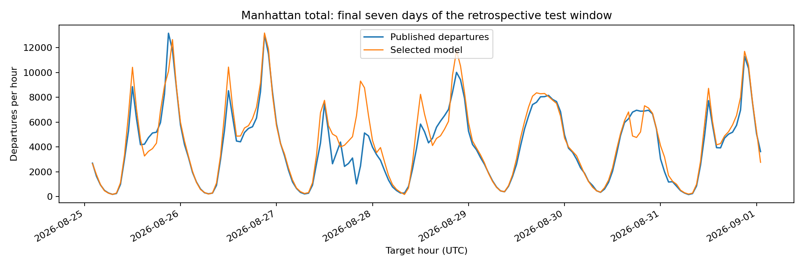

# Manhattan three-hour departure benchmark model card

**Owner:** Randy Howk. **Version:** `20261016T005315Z-35753b1b-9ac3c3ff`. **Training:** October 15, 2026, New York date, in Databricks Free Edition. **Status:** public-data feasibility benchmark with live forecast issuance; original station-level and alert-ablation scope remains incomplete.

## Purpose and scope

Predict served Citi Bike departures across Manhattan for each of the next three separate hourly intervals. Intended use is a borough-level volume demonstration and evaluation of weather forecast features. The output is an expected count, without a calibrated prediction interval. It does not estimate latent demand, identify station shortages, allocate rebalancing resources, estimate causal weather effects or measure subway disruption effects.

Labels count eligible published trip departures whose actual start coordinates intersect the downloaded Manhattan boundary. Training profiles use released historical geographic hours. Public CityBikes operation interpolation is excluded from this model because eligibility in that archive depends strongly on inventory activity. No demographic or person-level features are used.

## Training and selection

Training: March 2025–March 2026; validation: April–May 2026; test: June–August 2026. Target intervals crossing a split boundary or an ambiguous fall-back local hour are excluded. With complete weather, the sets contain **28,149 / 4,386 / 6,564 forecast rows** respectively. There are three horizons per retained origin; overlapping target hours are expected, so rows are not independent observations. All candidates use the same covered keys.

Features are released hour-of-week/hour-of-day profiles, calendar cycles, day of week, horizon, and forecast temperature, squared temperature, precipitation, wind and wet indicator. All preprocessing is fitted on training data. Source-month release is assumed at month end plus 45 days, 00:00 UTC. Forecast run availability is assumed at initialization plus seven hours, with inputs frozen five minutes before the nominal origin. No recent trip-count lags are used. Instantaneous weather uses target start; accumulated precipitation uses target end. A single Manhattan reference weather point serves the borough.

The fixed design compares two arithmetic baselines and calendar/weather Poisson regressions with regularization 0.1 or 1.0. All four regressions converged. Validation MAE selected **weather Poisson, alpha 0.1**, before test evaluation. The fallback is **calendar Poisson, alpha 0.1**. The alpha 1.0 weather model has slightly lower test MAE, but is not substituted after seeing the test result. Training/import/model checks took 42.55 seconds inside the successful notebook. Saved/reloaded predictions match exactly.

## Retrospective performance

Errors are departures **per Manhattan hour**, pooled over three horizons on 6,564 weather-covered test rows. These are retrospective development results, not prospective production accuracy.

| Model | Validation MAE | Test MAE | Test RMSE |
|---|---:|---:|---:|
| Pooled hour-of-day profile | 1,211.39 | 1,531.56 | 2,062.80 |
| Hour-of-week profile | 945.10 | 1,385.91 | 1,820.04 |
| Calendar Poisson, alpha 0.1 | 908.34 | 815.81 | 1,476.96 |
| Selected weather Poisson, alpha 0.1 | **558.63** | **761.00** | **1,235.17** |

The selected model reduces test MAE by **45.09%** relative to the hour-of-week profile and **6.72%** relative to the selected calendar fallback. Its test Poisson deviance is 285.62, mean prediction bias +18.02 departures/hour, and actual mean 4,310.72 departures/hour. Test weather coverage is 6,564 of 6,618 eligible forecast rows (99.18%); uncovered rows are not included in the weather comparison.

| Horizon / interval from origin | Test rows | MAE | RMSE |
|---|---:|---:|---:|
| 1 / `[T,T+1h)` | 2,188 | 758.27 | 1,231.72 |
| 2 / `[T+1h,T+2h)` | 2,188 | 760.55 | 1,233.12 |
| 3 / `[T+2h,T+3h)` | 2,188 | 764.19 | 1,240.66 |

Full candidate, horizon and wet/dry metrics are retained in the immutable cloud model report and [execution evidence](validation/public_only_mvp_2026-10-15.json). MLflow run: `5ab46264c9ea4771a81f8d250e89b8f0`.

A separate [release-aware monthly analysis](release_aware_evidence_pipeline.md) now gates fitting, validation selection and refitting by assumed label publication, including supplying-source cohorts. June–August monthly selections yield pooled MAE **767.77** versus weekly profile **1,386.49** on **6,552** covered rows. The additional monthly-boundary purge differs from the original 6,564-row test above. June's selected weather model underperforms the calendar comparison (734.30 versus 649.80 MAE); July/August and all selection evidence remain in that analysis. These previously inspected months are additional retrospective evidence, not an independent new test. This analysis does not replace or promote the active model described here.

The frozen model was also checked under hypothetical six-, seven- and eight-hour weather-availability delays, without refitting or changing the seven-hour assumption. On 4,386 common validation rows, MAE was 557.89 / 558.63 / 562.78 respectively. On 6,552 common test rows, it was 759.07 / 759.49 / 759.30. The latter intersection is smaller than the main test set, so compare delays within this sensitivity result. Similar errors do not establish actual historical public availability. The report is saved separately from model selection.

## Deployment and limits

The hourly UTC `:55` job collects inputs, then scores the next top-of-hour origin. Persisted keys are scope/origin/horizon/model version; a retry preserves the original prediction. Actual persistence completion determines on-time status. Missing, stale or null weather invokes the calendar fallback with a reason. Both the package and model are checked by SHA-256 before scoring. The first verified origin was October 15, 2026 at 21:00 New York time (October 16 01:00 UTC); all three predictions were persisted before their targets. Actual trip outcomes for that origin are not yet published, so there is no live departure-accuracy claim.

Serving and verification pin serverless environment 5 and scikit-learn 1.7.2; the verified runtime is Python 3.12.3, NumPy 2.1.3, PyArrow 21.0.0 and joblib 1.4.2. Cross-process predictions match the saved test outputs within 2.37e-11. A stale-weather late retry exercised the calendar fallback and preserved the original weather predictions and publication times. The imported historical outcome table currently yields zero matured live forecasts, correctly leaving prospective accuracy unavailable.

Early historical weather runs include hindcasts, actual historical release timestamps are unverified, and model versions change within the archive. May validation labels were not available at the first June test origin under the delayed-release assumption. Consequently this is retrospective model development with availability-controlled features, not a precise historic deployment simulation. Aggregate geography removes the station-operation denominator problem but also removes the original station-level use case. No historical alert features are present. The current model is frozen; no automatic retraining is enabled. Monitor drift, source freshness, failed/late runs and eventual released trip outcomes before treating it as a production decision tool.

See the [public-only runbook and scope decision](public_only_mvp.md) and [weather dataset datasheet](weather_reference_datasheet.md). The original proposal and class shared-catalog requirement remain unchanged.
