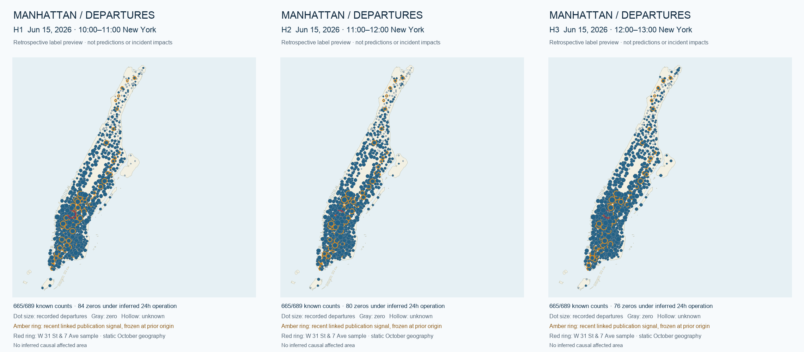

# Three-horizon departure feature preview

Preview of proposed revisions, not a replacement for the published panel or a trained model. W 31 St & 7 Ave (`6331.01`), origin 2026-06-15T10:00:00-04:00. Blank CSV cells mean unknown.

## Labels

| horizon | target_start_new_york | departures | label_basis | inventory_required |
|---|---|---|---|---|
| 1 | 2026-06-15T10:00:00-04:00 | 17 | observed_trips | False |
| 2 | 2026-06-15T11:00:00-04:00 | 14 | observed_trips | False |
| 3 | 2026-06-15T12:00:00-04:00 | 18 | observed_trips | False |

## Weather and subway timing

| horizon | departure_start_new_york | departure_end_new_york | temperature_stamp_new_york | precipitation_stamp_new_york | subway_snapshot_new_york | issue_cutoff_new_york |
|---|---|---|---|---|---|---|
| 1 | 2026-06-15T10:00:00-04:00 | 2026-06-15T11:00:00-04:00 | 2026-06-15T10:00:00-04:00 | 2026-06-15T11:00:00-04:00 | 2026-06-15T09:00:00-04:00 | 2026-06-15T09:55:00-04:00 |
| 2 | 2026-06-15T11:00:00-04:00 | 2026-06-15T12:00:00-04:00 | 2026-06-15T11:00:00-04:00 | 2026-06-15T12:00:00-04:00 | 2026-06-15T09:00:00-04:00 | 2026-06-15T09:55:00-04:00 |
| 3 | 2026-06-15T12:00:00-04:00 | 2026-06-15T13:00:00-04:00 | 2026-06-15T12:00:00-04:00 | 2026-06-15T13:00:00-04:00 | 2026-06-15T09:00:00-04:00 | 2026-06-15T09:55:00-04:00 |

## Feature values

| horizon | forecast_temperature_f | forecast_precipitation_in | forecast_wind_speed_mph | recent_event_count |
|---|---|---|---|---|
| 1 | 69.5 | 0.0 | 8.6 | 0 |
| 2 | 71.2 | 0.0 | 8.4 | 0 |
| 3 | 72.6 | 0.0 | 8.2 | 0 |

## Released demand profiles

| horizon | released_profile_mean | profile_departures | profile_hours | profile_included_releases | profile_latest_input_available_utc |
|---|---|---|---|---|---|
| 1 | 10.625 | 85 | 8 | 2026-03, 2026-04 | 2026-06-14T00:00:00+00:00 |
| 2 | 13.375 | 107 | 8 | 2026-03, 2026-04 | 2026-06-14T00:00:00+00:00 |
| 3 | 12.5 | 100 | 8 | 2026-03, 2026-04 | 2026-06-14T00:00:00+00:00 |

Full column names and three actual rows are in [features.csv](features.csv), [labels.csv](labels.csv), [timing_alignment.csv](timing_alignment.csv), and [station_crosswalk.csv](station_crosswalk.csv).

## Zero-policy edge examples

| station_id | origin_utc | horizon | target_start_new_york | departures | label_basis | inventory_required |
|---|---|---|---|---|---|---|
| 4374.01 | 2026-06-15T14:00:00+00:00 | 2 | 2026-06-15T11:00:00-04:00 | 0 | assumed_24h_zero | False |
| 5216.06 | 2026-06-15T14:00:00+00:00 | 1 | 2026-06-15T10:00:00-04:00 | unknown | outside_inferred_active_period | False |

[CSV](zero_policy_examples.csv). These two examples use actual missing source counts; only the first is inside its inferred active days.

## Map preview

[Animated three-frame demo](map_preview.gif). This animates recorded departure labels, not model forecasts or measured incident impacts. Amber rings are prior-origin publication signals and stay fixed across horizons.
