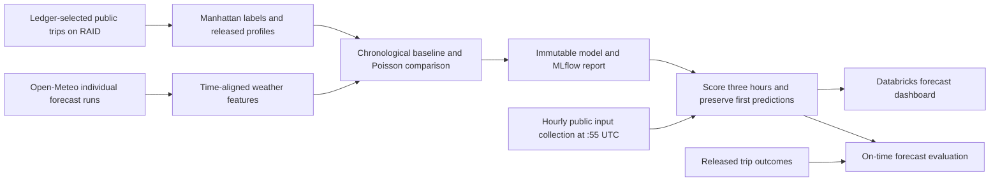

# Public-only MVP demonstration notes

Randy presents and operates all workstreams. This demonstrates a working **Manhattan-total** three-hour benchmark, while keeping the original station-level proposal and remaining requirements explicit. The course [midterm format](https://georgehagstrom.github.io/DATA622Fall2026/assignments/project.html) is approximately five minutes of three slides and five minutes of live demonstration, November 2–7.

The finished [PowerPoint](presentations/data622_mvp.pptx) has three editable slides, timed speaker notes and a live dashboard link. The matching [PDF](presentations/data622_mvp.pdf) and slide PNG previews are in `presentations/`. The [timed narration and navigation script](midterm_demo_script.md) includes questions and an offline fallback. Rebuild with `uv run python scripts/build_mvp_slides.py`; metrics come from saved validation reports, without retraining. The [whitepaper draft](technical_whitepaper_draft.md) and [PDF](presentations/data622_whitepaper_draft.pdf) develop the methods and limits. Refresh the dated operational evidence before presenting.

## Slide 1: problem and implemented scope

Forecast served Citi Bike departures across Manhattan in three separate future hours. Published monthly trips supply labels and older profiles; individual weather runs supply forecast inputs. Public-only development avoids waiting for class data. The public station archive records inventory changes: only 0.147% of its conservatively covered hours have zero departures, making unconditional station accuracy unsupported. Borough totals provide a defensible feasibility benchmark. Station predictions and subway-disruption effects remain extensions.

## Slide 2: running system

Mention actual input cutoffs, 45-day trip-release and seven-hour weather-delay assumptions, UTC scheduling, null DST labels, fallback and first-write persistence. No recent trip counts or future trip properties are predictors. The model runs in Databricks Free Edition; bulk trip data stays on the RAID.

## Slide 3: results and remaining work

The primary slide now shows the release-aware monthly analysis: **767.77 departures per Manhattan hour** versus **1,386.49** for the weekly profile on **6,552 common rows** from June–August 2026. Monthly selected-model MAEs are 734.30, 839.87 and 727.24; June calendar performs better at 649.80. Fitting, selection and refitting use only labels available under the release assumption. These previously inspected months remain retrospective evidence with hindcast/release assumptions. They are not an independent new holdout or production accuracy.

The original frozen-model evaluation remains **761.00** versus profile **1,385.91** and calendar **815.81**, on **6,564** common weather-complete rows. Extra monthly-boundary purges explain the different row count. Keep the designs separate; the monthly audit does not replace the active model. All fits converged. See [September data refresh and verification](september_refresh.md) for the latest data and local/cloud checks.

The [prospective station/subway mapping](station_subway_mapping.md) and [daily operational monitoring](daily_forecast_health.md) are deployed. Remaining work: reliable historical station operation/geography, historically supported alert features, class-workspace deployment/shared-catalog transfer, and released production outcomes. The external weather handoff is packaged, documented and tested in the private workspace; class publication remains incomplete. Monitoring distinguishes delivered forecasts from predictive accuracy while outcomes mature.

## Five-minute live demonstration

1. Open the [forecast dashboard](https://dbc-d00cbd4c-c74c.cloud.databricks.com/editor/notebooks/2763628353985993). Show three separate hourly targets, New York/UTC times, model, profile release, fallback status and publication timing. Explain that predictions are Manhattan totals.
2. Show release-aware monthly comparisons and the June calendar advantage. Keep the original model table/test-week plot separately labeled. Point to the [model card](manhattan_benchmark_model_card.md), chronological windows and weather-delay sensitivity.
3. Open the [hourly job](https://dbc-d00cbd4c-c74c.cloud.databricks.com/jobs/1072725421467387): collection then scoring, `:55 UTC`, one concurrent run, bounded timeouts. Inspect a successful run and source statuses.
4. Show the station/subway coverage at 250m and 500m, prospective evidence tables and [weather datasheet](weather_reference_datasheet.md). Use the [station/advisory datasheet](prospective_station_alert_datasheet.md) to explain missingness and timing. Explain why current mappings cannot establish historical operation, and how the weather handoff transfers to the class catalog.
5. Show daily health and retry evidence: a late attempt selected the stale-weather calendar fallback but preserved the first three weather predictions and original publication times. Show the outcome-evaluation view: zero matured live forecasts until matching published trips are imported. End with the remaining station/alert/class-sharing work.

Before presenting, rerun dashboard and verification, check the most recent scheduled run, and replace this preparation snapshot with actual accumulated operational results. Do not trigger training just to refresh the demonstration. Forecast accuracy should be refreshed only after genuine outcomes are available.
