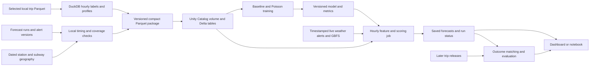

# Three hour Citi Bike MVP on Databricks Free Edition

**Planning date:** October 15, 2026. **Team:** Michael Mayne, Farhod Ibragimov, Jonathan Cruz, Randy Howk. **Current operator:** Randy handles every workstream until responsibilities are reassigned. **Account:** Randy has an existing Databricks Free Edition account.

Build one reproducible forecasting workflow for one borough: prepare hourly labels and source mappings locally, upload compact tables, train a historical baseline and Poisson model, and save three hourly predictions per station through a scheduled Databricks notebook job. Use weather first to establish the complete workflow, then add alert features that pass timing and coverage checks. The supplied [Word proposal](citibike_proposal_4_pages_for_revisions.docx) defines this scope; the repository's neighborhood and next-day export plans describe earlier work.

The full proposed MVP includes weather and alert tables, supported model ablations, a scheduled scoring demonstration, and an interface showing forecasts and cutoffs. If the alert or operating-history gates fail, document a reduced deliverable for instructor review; do not call that the complete proposed MVP. The user authorized public-only execution: a real **Manhattan-total** benchmark is trained, evaluated and issuing forecasts; see its [scope decision/runbook](public_only_mvp.md), [model card](manhattan_benchmark_model_card.md) and [execution status](three_hour_execution_status.md). This does not complete the original station-level model or alert ablation.

## Course deliverables and dates

The [assignment](https://georgehagstrom.github.io/DATA622Fall2026/assignments/project.html) places the midterm demonstration in **November 2–7**, with roughly five minutes of slides and five minutes of demonstration. Production begins **November 16** and runs for four weeks, with final presentations during the week of **December 14** and documentation due **December 18**. Plan to finish the MVP by November 1 and use November 8–15 for production hardening.

Prepare three slides covering the forecasting problem, system architecture, and remaining challenges. Publish at least one documented external dataset to the **class shared catalog**. Confirm the authorized delivery route now: the class workspace invitation, catalog name, schema permissions, and access to historical station tables remain unverified. Free Edition supports development but does not automatically connect a personal account to the course catalog.

## Existing assets and first dependencies

| Item | Reuse or next action |
|---|---|
| Normalized trip archive and selected-file ledger | RAID access confirmed. Selected status, existence, and Parquet metadata pass for 161 files covering August 2024–August 2026, including warm-up history. |
| Existing daily export and import pattern | Reuse manifest/checksum/validation ideas. Rebuild the target grain from trips; daily counts cannot recover hourly counts. |
| Earlier neighborhood proposal, Census plan, and daily scoring design | Preserve as prior work. Census integration is outside this proposal's critical path. |
| Capstone Open-Meteo cache | Locate and audit coordinates, model runs, units, dates, and metadata before more downloading. |
| Historical station operation and geography | Obtain the class tables or a documented alternative. This controls valid zeros and the borough cohort. |
| Alert history | Exact dataset found; coverage and timestamp semantics need the gate below. |
| Free Edition account | Run a capability pilot inside the existing account before any large upload or training. |

The full [source register](three_hour_mvp_data_sources.md) and [initial source audit](validation/data622_mvp_source_audit_2026-10-15.json) identify endpoints, observed fields, data gaps, and the initial RAID verification. The selected input files contain 96,703,344 ledger rows. Subsequent execution scanned these inputs for hourly aggregation and imported the compact results to Databricks; see the [execution evidence](validation/three_hour_execution_2026-10-15.json). One local September 29 station-status snapshot is available, but it cannot supply historical operating intervals.

## Architecture and workspace setup

Use Randy's integration workspace for authoritative outputs. Execute the workstreams sequentially: trip aggregates and operation coverage; weather and source manifests; alert ingestion and geography; integration, evaluation, and demo. Randy owns each package and the final scheduled job. Teammates can later contribute code and versioned artifacts without requiring four accounts.

Current [Free Edition limits](https://docs.databricks.com/aws/en/getting-started/free-edition-limitations) include serverless compute, restricted outbound domains, one SQL warehouse up to 2X-Small, five concurrent job tasks, and fair-use shutdowns that may last the day or month. Apps stop after 24 hours. These constraints favor sequential notebook jobs and an on-demand dashboard. No universal guaranteed compute-minute allowance is published there. Set project runtime budgets and measure them in the actual account; hourly operation for four weeks is a feasibility gate.

In the workspace, discover a writable catalog and create schema `citibike_3h`, with managed volumes `inputs`, `models`, and `exports`. Use the actual catalog name in configuration. Upload a tiny Parquet file, create a managed Delta table, fit a small Python model, save/reload it, and schedule a single test run. Check access to Open-Meteo, the MTA feed, and GBFS from the notebook driver. Successful local probes do not establish Databricks egress permissions.

Use absolute `/Volumes/<catalog>/citibike_3h/inputs/<build_id>/...` paths. [Unity Catalog volumes](https://docs.databricks.com/aws/en/volumes/volume-files) support UI uploads and programmatic transfer, with a 5 GB UI limit per file. Start with manual package upload, then verify supported authentication and automated upload if an external live collector is needed. Do not depend on an external collector until its full upload-to-table route succeeds.

[Serverless notebooks](https://docs.databricks.com/aws/en/compute/serverless/limitations) use Spark Connect, limited DBFS access, and UTC by default. Use SQL/DataFrames and managed Delta tables; configure Python dependencies through notebook/environment settings. Keep UTC keys and compute New York calendar features explicitly. No cluster init scripts, RDD workflow, GPU, serving endpoint, or continuously running process is needed.

## Data contracts

For nominal origin `T`, define horizon 1 as departures in `[T,T+1h)`, horizon 2 in `[T+1h,T+2h)`, and horizon 3 in `[T+2h,T+3h)`. The intervals are separate hourly counts, not cumulative totals. Store UTC start/end and New York calendar attributes, including UTC offset. All feature availability must precede the actual issue cutoff.

| Proposed table | Grain | Required contract |
|---|---|---|
| `source_availability` | Source/version | Release or run, retrieval, availability evidence/assumption, checksum, coverage and units |
| `station_operation_interval` | Station/effective interval | String ID and scheme, location version, operation/coverage evidence and uncertainty |
| `station_hour` | Station/UTC hour/label version | Departures, separate arrivals if used, coverage, operation eligibility, source releases and DST handling |
| `demand_profile` | Station/hour of week/profile version | Released historical count and operating exposure, rate, fallback level and source cutoff |
| `nyc_weather_forecast_run` | Cell/model/run/valid hour | Initialization, interval bounds, availability, variables, units and hindcast provenance |
| `subway_alert_version` | Feed/event/version | Publication when supported, first seen, route/stop references, status and snapshot coverage |
| `station_crosswalk` | Station/location/linked stop or cell | IDs, route/cell, distance, effective dates, source geography and mapping confidence |
| `forecast_output` | Station/origin/horizon/model version | Target interval, prediction, issue time, profile/weather/alert cutoffs, package hash and quality status |
| `evaluation` and `run_status` | Forecast key or run | Later labels and metrics; missing/stale inputs, coverage, runtime and on-time status |

Keep labels separate from predictors and match outcomes later. Use Delta tables for queryable data and volumes for uploaded files and model artifacts. Partition larger historical label files by month locally; avoid tiny station/horizon partitions. Choose cloud Delta partitioning after measuring table sizes rather than requiring it for every small table.

Generate an hourly UTC grid only for intervals with justified station operation and complete trip coverage. Missing stations, closed stations, unknown exposure, and missing source files do not become zero departures. A completed ride's duration, destination, membership, or bike type cannot describe a future ride; only released historical summaries can be features. Keep normalized audit columns and the source archive intact.

The canonical timestamps are New York wall-clock values without UTC conversion. Flagged ambiguous fall-back and nonexistent spring-forward timestamps need explicit handling. Where the repeated-hour offset cannot be recovered, quarantine the hourly assignment and exclude affected evaluation intervals, preserving count reconciliation in a separate audit. Never silently assign both repeated hours to a guessed offset.

## Pilot scale and compute budget

Start with **up to 200 stations and two weeks from the training period** for engineering checks, then cover the selected borough across March 2025–August 2026. Choose Manhattan provisionally for the pilot; finalize the cohort from verified geography and operation coverage, without selecting stations by test activity. The full borough is the intended deliverable, not merely the 200-station development sample.

| Planning case | Hourly label rows | Three-horizon rows before filtering |
|---|---:|---:|
| 200 stations × 336 hours | 67,200 | 201,600 |
| Illustrative 500-station borough × 13,176 UTC hours | 6,588,000 | 19,764,000 |
| Proposal estimate of 2,000 stations × 13,176 hours | 26,352,000 | 79,056,000 |

These are sizing calculations, not measured station counts. Keep the base hourly table and shared weather/alert dimensions compact; expand horizons in bounded batches. Do not collect the borough's entire expanded dataset into pandas. Initially cap model fitting at roughly 250,000–500,000 deterministically selected training rows across months, stations, hours, and horizons, with sampling weights if inclusion probabilities differ. Use the same selected rows for ablations and evaluate all eligible holdout rows in batches. Expand training only after measuring memory and accuracy.

Use a local DuckDB cap around 3 GB and four threads, with sequential RAID reads. Set provisional cloud budgets of ten minutes for package import, fifteen minutes per candidate training run, and two minutes for a scoring run. These are stop-and-review targets, not platform quotas. At two minutes per hourly run, 28 days implies 1,344 job wall-clock minutes before development, startup, and dashboard use. Measure a representative 24–48-hour run before promising four-week Free Edition operation. If it fails, reduce workload and training costs; use an authorized class workspace for sustained production if necessary.

The completed ensemble packages remain below 500,000 rows and 1.2 GB peak process RSS, so converting the current model fitting to Spark ML is not warranted. Databricks supplies managed execution and MLflow without requiring a distributed estimator. The [Spark scaling decision](spark_scaling_decision.md) retains the single-node model path and defines when to benchmark Spark for larger, cloud-resident ingestion, joins, window features and incremental partition refreshes. Any later Spark implementation must reproduce the existing package keys, release cutoffs and null rules before it replaces a preparation step.

## Models and evaluation

The October 20 [ensemble result](ensemble_results.md) executes the bounded tree experiment on common station/calendar/weather keys and a separate inventory comparison. Station histogram boosting wins validation and September development MAE; inventory random forests are not selected. Both Free Edition runs stay within the planned resource limits. They preserve the completed studies, original proposal and alert/operation gates, and do not activate a model.

Build two arithmetic baselines: a station profile for the target hour of week, and a pooled calendar profile for sparse or new stations. Rates require covered operating hours, including justified zeros. Build monthly versioned profiles from already released history; the existing month-end-plus-45-days schedule is an unverified assumption until better evidence is recorded. Exclude recent 1–3-hour, yesterday, and last-week trip-count lags from the core workflow.

Fit [regularized Poisson regression](https://scikit-learn.org/stable/modules/generated/sklearn.linear_model.PoissonRegressor.html) first. Use calendar, horizon, historical profile, weather, and supported alert variables. Encode categories deliberately, fit preprocessing on training data, and preserve feature order. Station indicators should remain sparse if included. Start with a small fixed configuration and at most a few validation-based alternatives.

Run four otherwise identical Poisson comparisons on the same eligible keys: calendar/profiles; plus weather; plus alerts; plus both. Also report weather-only improvements over the broader weather-covered cohort, separately from the common alert-covered cohort. Do not manufacture alert zeros to retain every row. If time and the measured budget permit, add a single bounded [histogram gradient boosting model with Poisson loss](https://scikit-learn.org/stable/modules/generated/sklearn.ensemble.HistGradientBoostingRegressor.html), initially about 100 iterations and small trees. Trees are the next extension after baseline and Poisson work end to end.

Retain the proposal's chronological windows: training March 2025–March 2026; validation April–May 2026; test June–August 2026. Split by origin and purge any origin whose target intervals cross a boundary. Early stopping must use an explicit chronological validation strategy supported by the installed version; disable automatic random validation splits. Freeze preprocessing, radius, features, and model settings before test evaluation.

Historical input cutoffs and model-selection timing are different checks. May validation outcomes are not available at a June 1 historical deployment origin under delayed monthly publication. Label this split-based study as **retrospective model development**, also disclosing the weather hindcasts. For a stricter historical deployment simulation, freeze settings using matured labels before the first origin, or start after validation labels become available. Under the 45-day assumption, all May outcomes mature July 15; verify the exact timestamp before selecting eligible origins. Prospective October/November scoring uses a model frozen before its forecasts occur.

Report MAE, Poisson deviance, and RMSE by horizon, plus wet/dry, hour, training-defined station activity, and supported alert exposure. Use positive clipping only where the deviance calculation requires it and document the rule. Report cohort sizes, excluded dates/stations, and day-block uncertainty for alert comparisons. A model does not need to beat the baseline to demonstrate the pipeline; retain the baseline as the deployed fallback if candidates fail the predefined validation rule.

Track experiments, environment versions, and artifacts through [MLflow](https://docs.databricks.com/aws/en/mlflow/tracking), after verifying fit/save/reload in the capability pilot. A versioned model file plus explicit Delta metadata is a recovery option if tracking integration fails. Training remains batch after validated trip releases, not online.

## Feasibility gates and fallback behavior

| Gate and deadline | Evidence needed | Action if unresolved |
|---|---|---|
| Workspace and collector by October 17 | Delta read/write, model reload, scheduled test; verified source egress or automated external upload | Fix this small workflow before uploading the borough package. Manual live uploads support a demo, not unattended production. |
| Operation and borough coverage by October 19 | Dated IDs, locations, operation intervals and coverage for targets and profile denominators | Reduce to a documented eligible cohort. Positive-hour-only evaluation remains a conditional experiment and a proposal gap. |
| Historical alert features by October 19 | Verified timezone, usable revision ordering, route mapping and coverage/lookback rules | Preserve raw/version tables and show prospective ingestion. Do not claim a completed historical disruption ablation; take the scoped limitation to the instructor. |
| Weather by October 19 | Cache audit, tested cells/runs, interval alignment and complete required forecast variables | Fetch missing runs conservatively; mark unavailable rows. HRRR is optional, not an emergency rewrite. |
| Free Edition hourly feasibility by October 29 | Representative 24–48-hour scheduled run with actual durations and freshness | Reduce costs, preserve the last timestamped forecast, and determine a class-workspace production route before November 16. |

The alert audit already found records ending August 11 and no records on the final day of each prior month checked. Resolve those windows before declaring absence of alerts. Begin with recent publication features because the archive lacks explicit active-period/end and planned/unplanned columns. Mapping a route alert to nearby stations is a proximity proxy. Reconstruct active incidents only if the underlying evidence supports it.

Prospective weather/alert outages should invoke a separately validated calendar/profile model, with `fallback_reason`, or an unavailable prediction. Missing alert coverage is a distinct state. Forecasts should retain their selected model and source versions even when the fallback runs.

## Hourly operation and outcome monitoring

Schedule in UTC to avoid repeated or skipped New York clock hours. [Databricks scheduling guidance](https://docs.databricks.com/aws/en/jobs/scheduled) notes that runs can be delayed by several minutes. To publish before the target hour, initially trigger around **:55 for the next :00 origin**, freeze inputs at the actual collection cutoff, and require `issued_at < target_start`. This is a forecast issued several minutes ahead of the nominal hourly origin. Match that earlier cutoff in any directly comparable backtest. Store late runs as late; never relabel them as on-time top-of-hour predictions.

Use one job with sequential collect/validate, feature/score, and persist/status stages; combine stages into one notebook if startup costs dominate. Set maximum concurrent runs to one and bounded retries. Initial retry policy can be no automatic retry until failures are understood. A run should score only the few thousand station-horizon rows needed for that origin, using small released profiles and the accepted model.

Persist predictions by station, origin, horizon, and model version. A retry must preserve the first issued prediction rather than overwrite it. Store actual collection/issue times, weather run and retrieval, alert snapshot, profile release cutoff, mapping version, model version, package hash, and freshness/quality flags. Catch-up runs are reconstructions and belong outside prospective on-time metrics.

Collect raw alerts/GBFS on a modest five-minute cadence through a verified collector when practical; collect information snapshots daily and forecast weather by new model run. The collector can run outside Databricks if egress or startup cost requires it, but its host must remain awake and its automated volume upload must pass the pilot. Historical class GBFS coverage and actual feed TTLs guide final collection settings.

Join observed departure labels only after a validated trip release arrives. Show predictions awaiting outcomes separately from evaluated predictions. Four weeks of saved November–December forecasts may not all have published trip labels by December 18. Seek validated fresher departure outcomes from the class; inventory changes alone do not identify rentals. Report only the live accuracy that can actually be measured, plus historical results and collection/run reliability.

## Delivery schedule

| Dates in 2026 | Work | Reviewable output |
|---|---|---|
| October 15–17 | Use verified RAID inputs, locate weather cache, verify Free Edition capabilities and class-table route | Input inventory, tiny scheduled run, collector/upload decision |
| October 18–20 | Audit operation/IDs, alerts, timezones, geography and weather; aggregate development sample | Hourly counts reconcile; explicit coverage gates pass or scoped gaps recorded |
| October 21–23 | Build borough package and released profiles; import; implement baselines | Versioned manifest, Delta tables, reproducible validation metrics |
| October 24–26 | Fit Poisson comparisons; evaluate supported ablations; select model | MLflow runs/artifacts, fixed validation keys, coverage-aware comparison |
| October 27–29 | Integrate hourly scoring and dashboard; exercise missed/stale/retry cases | Saved forecasts, model reload parity, 24–48-hour scheduling evidence |
| October 30–November 1 | Publish weather contribution to class catalog; evaluate frozen holdout; rehearse | Queryable external table, three slides, five-minute demo, limitations/runbook |
| November 2–7 | Midterm check-in | Demonstrate the complete supported workflow and remaining gaps |
| November 8–15 | Harden collection, quotas, recovery and monitoring | Production readiness review and frozen model/configuration |
| November 16–December 14 | Scheduled operation with monitored forecasts | Immutable predictions, actual run history and available outcome metrics |
| December 14–18 | Present and finalize documentation | Model card, external-data datasheet, runbook, approximately 2,000-word technical report |

Use the notebook/dashboard for the MVP interface: three horizon predictions for a selected station, a map or station list, historical predicted/observed curves, baseline comparisons, feature ablations, and source cutoff/coverage/run status. Precompute summaries rather than querying every expanded row during the demo. Keep a clearly labeled historical replay and saved tables as recovery material if compute is unavailable during the presentation.

## MVP acceptance checklist

- Hourly departure totals reconcile to selected eligible trip records, with exclusions and DST uncertainty accounted for; valid zero hours have operation and coverage evidence.
- The documented borough cohort, trip ↔ GBFS ↔ subway mappings, weather cells, and source availability rules are versioned.
- Baselines and a saved/reloaded Poisson model use identical feature definitions during historical and live scoring; supported ablations share evaluation keys.
- Predictions are saved before the target intervals, and retry, stale-input fallback, pending outcomes, and missed runs are visible.
- Historical metrics include denominators, source limitations, and the distinction between retrospective study and prospective forecasts.
- The external weather table and dictionary are queryable by an authorized class user outside the personal workspace.
- The team can deliver three slides and a five-minute end-to-end demonstration, with a concrete runbook and the remaining source or quota limitations stated.
